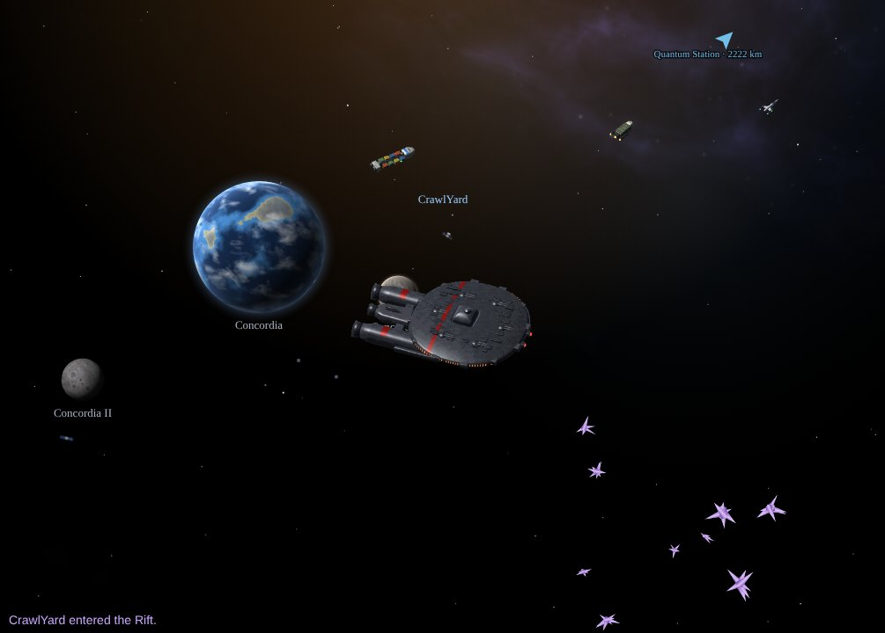
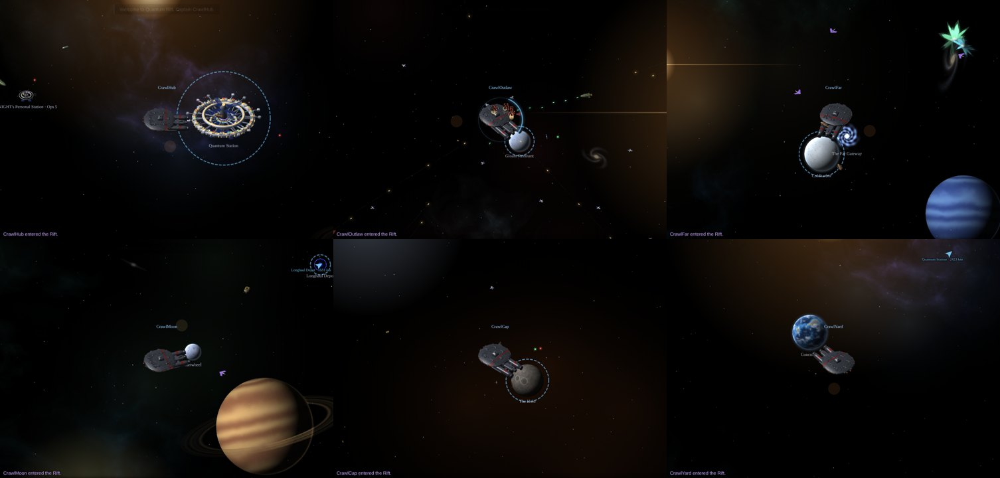
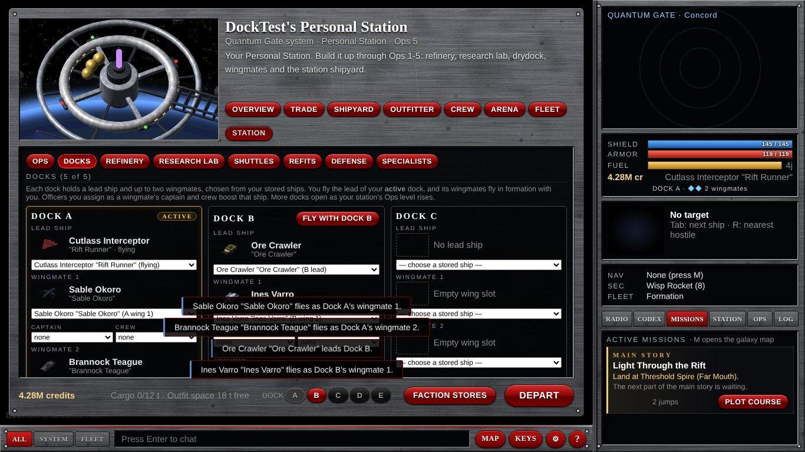
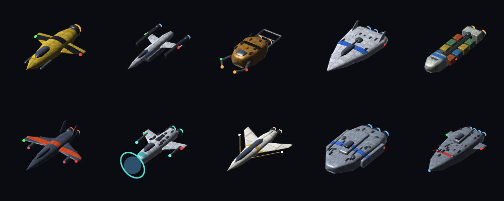

# Quantum Rift

**A space trading and combat game in your browser, in the spirit of the classic *Escape Velocity Nova*.**

Fly a ship through a living galaxy of more than 200 star systems. Trade between worlds, take jobs and bounties, mine asteroids, fight pirates, build up a Personal Station, and lead a fleet of crewed wingmates. Play alone, or host a server so friends can share the same galaxy.

Quantum Rift began as a rebuild of **EV Quantum**, a fan plug-in for EV Nova. Its ships, weapons, sounds and the Quantum Station come from that plug-in, and the game has grown far beyond it since.



---

## Features

**A big, living galaxy**
- 211 star systems across 14 powers: the Quantum Concord, free traders, pirates, five alien races and stranger things at the edges.
- Every system has its own scenery, generated from the system itself: its star, distant galaxies, gas giants, nebulae, ion storms, ancient wrecks, abandoned stations, crystal formations, comets and drifting debris.
- Procedurally generated planets and moons, asteroid fields, gas clouds and crystal fields to mine.
- Busy space lanes: traders, convoys, patrols, raiders and thirty named rival captains with careers of their own.
- Systems pass through famines, plagues, booms, border wars, pirate scourges, festivals and mining rushes that move prices and post their own jobs. Markets remember what you trade.

**Flight and combat in the EV style**
- Newtonian flight with guns, turrets, beams, homing missiles, point defense and drone carriers.
- Your guns hit anything you aim at. Shoot a friendly ship and it turns on you, and its faction remembers.
- NPC captains have personalities: some run when beaten, some call friends for help, and capital ships fire broadsides.
- Autopilot landing and multi-jump routes, a hyperspace jump with its own effect and sound, and hold-right-click to look ahead.
- Roughly 120 ships, from a 30,000-credit Wasp Skirmisher to the Constitution, plus ten one-of-a-kind specialty ships.

**A career to build**
- Trade on living markets with shortages and gluts. Take cargo runs, bounties, patrols, passengers, rush deliveries, smuggling and Syndicate contracts.
- **Questlines:** a contact in every spaceport bar who remembers you and has multi-step stories to offer, plus six handcrafted side stories.
- Claim a derelict station hull and build it into your **Personal Station**: refinery, research lab, refits to Mk II and Mk III, and a station shipyard.
- **Docks A to D:** each dock holds a lead ship and up to two wingmate ships, chosen from your hangar. You fly the active dock's lead, and its wingmates fly in formation and follow your orders.
- Hire officers of every race, promote them, and assign them to your bridge or as captain and crew of your wingmates.
- Combat ratings, faction story arcs, a Syndicate career, colonies, an arena and leaderboards.
- A main story waiting somewhere in the Rift. We won't spoil it.

**Made to be comfortable**
- Solo mode with pause, save slots and save files, or online play with accounts. Solo games hide the multiplayer screens.
- Newcomer protection: pirates in inner space leave new captains alone until their station reaches Ops 3.
- An in-game radio with thousands of live stations, and a fully synthesized soundscape with a quick volume control.
- Key remapping, a colour-blind palette, interface scaling, gamepad and touch controls.
- No installs beyond Node.js: no npm packages, no build step.

| | |
|---|---|
|  |  |
| *Every system looks different* | *Docks A to D, with crewed wingmates* |
|  |  |
| *The galaxy map, with trade, standing and danger views* | *A hyperspace jump* |



---

## Play it

You need **[Node.js](https://nodejs.org) 18 or newer**. Nothing else to install.

**Windows:** double-click **`Start Solo Game.bat`** to play alone, or **`Start Quantum Rift.bat`** to host a game others can join. If Node isn't installed yet, the launcher opens the download page: install the LTS version, then run the launcher again. A console window opens (that's the server, leave it open) and the game opens in your browser.

**macOS / Linux:** run `start-solo.command` or `start.command`.

**By hand:**

```
node server/main.js           # online game on http://localhost:8080
SOLO=1 node server/main.js    # private single-player game
```

On the same network, friends can join at `http://<your-computer's-address>:8080`.

**Solo mode** only listens on your own computer, needs no passwords, and lets you pause with **P**. The login screen lists your captains, with **EXPORT** to download a captain as a file and **LOAD A SAVE FILE** to bring one back. Every server keeps a rolling backup of all saves every 30 minutes.

---

## Controls

| Key | Action |
|---|---|
| W / ↑ | thrust |
| A, D / ←, → | turn |
| S / ↓ | turn to reverse |
| Shift | afterburner |
| Space | fire primary weapons |
| F | fire secondary weapons; **tap** to launch or recall all drones |
| Tab / Shift+Tab | cycle targets |
| R | nearest hostile |
| L | land (the autopilot flies you in); also departs when docked |
| M | galaxy map: click a system to plot a course |
| J | jump along the plotted course, all the way to the destination |
| T | hail your target or a planet: bribe, beg fuel, talk to rival captains |
| B | board a disabled ship: plunder, capture or rescue |
| I | ship and captain panel |
| E (hold) | face your target |
| Q | full stop |
| K / G / H / Y / U | fleet orders: attack my target, form up, hold position, hold fire, collect loot |
| Z / X | zoom |
| N | mute |
| P | pause (solo) |
| Enter | chat (`/s` system, `/f` fleet) |
| ? or F1 | the controls card |
| Mouse | click to target, click a planet to set your nav point, double-click to land; **hold right-click and move** to look ahead; wheel to zoom |

Every key can be remapped in Options (the gear button, or **O**). A standard **gamepad** works out of the box, and touch screens get an on-screen stick and buttons.

---

## Host it online

Any host that runs a long-lived Node process with WebSockets will do:

- **Render.com:** a Web Service with start command `node server/main.js`, and a persistent disk at `/data` with `DATA_DIR=/data`. HTTPS and `wss://` work automatically.
- **Fly.io:** `fly launch` with the same start command and a volume for `DATA_DIR`.
- **Any Linux VPS:** run it with `pm2` or systemd, and put Caddy in front for HTTPS (`yourdomain.com { reverse_proxy localhost:8080 }`).

One small CPU handles dozens of players; only systems with players in them run at full rate.

| Setting | What it does |
|---|---|
| `PORT` | port to listen on (default 8080) |
| `DATA_DIR` | where saves go (default `./data`) |
| `SOLO=1` | single-player mode: local only, no passwords, pause, save slots |
| `SEEDS_FILE` | a file of ready-made captains to create on start-up |

---

## How it's built

- **Server:** plain Node.js ES modules with no dependencies. It has its own small WebSocket implementation and JSON save files written atomically. Each star system is simulated at 30 Hz, and systems nobody is in go to sleep.
- **Client:** HTML canvas and vanilla JavaScript. Your own ship is predicted locally, so it responds instantly. Planets are rendered procedurally in the browser.
- **Art and audio:** ship sprites come from a small Python 3D pipeline, and system scenery from procedural renderers (`tools/rift_decor*.py`). All interface sounds, ambience and the login theme are synthesized from scratch (`tools/rift_audio*.py`).
- **Tests:** in-process suites for every release, a message fuzzer, a balance report, and a Playwright UI crawler that clicks every screen.

**[DEVELOPMENT.md](DEVELOPMENT.md)** is the guide for anyone, or any AI assistant, picking up the code: the architecture, how to add a feature, how to test it, and the full list of test suites. **[CHANGELOG.md](CHANGELOG.md)** has every release from 0.3 to today.

---

## Credits

- *Escape Velocity Nova* (Ambrosia Software / ATMOS): the game that started it all. Quantum Rift is an unofficial fan project and is not affiliated with them.
- **EV Quantum**, the EV Nova plug-in whose ships, weapons, sounds and stations Quantum Rift was rebuilt from.
- *Endless Sky* and *Star Trek Fleet Command*, for ideas: hailing, fleet orders and map views from the first; specialty ships, docks and armadas from the second.
- The in-game radio uses the public iHeartRadio station directory.
