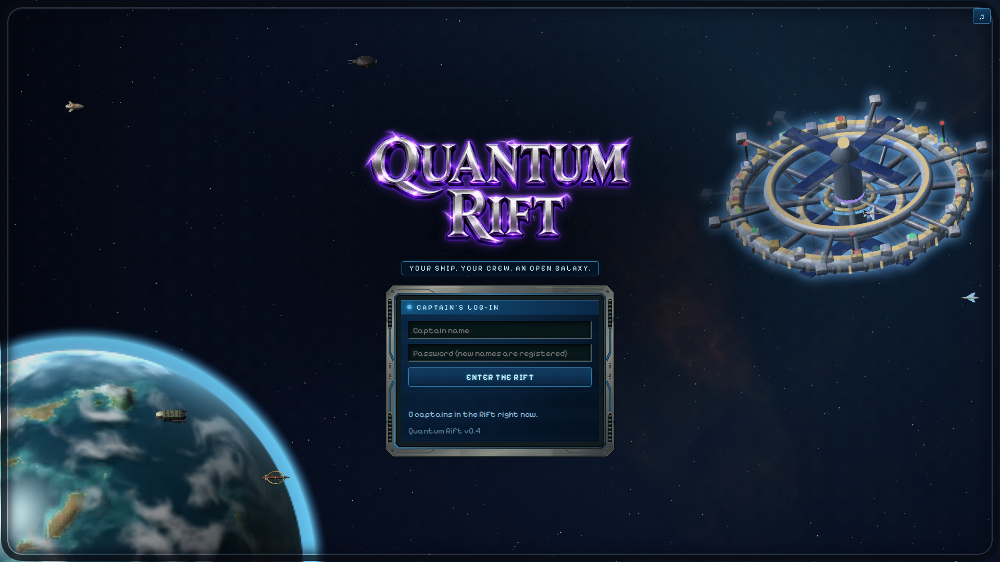
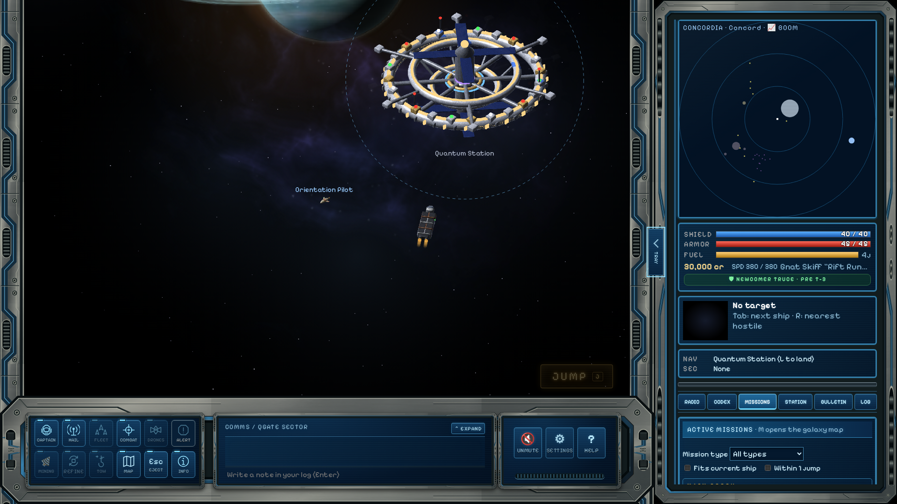
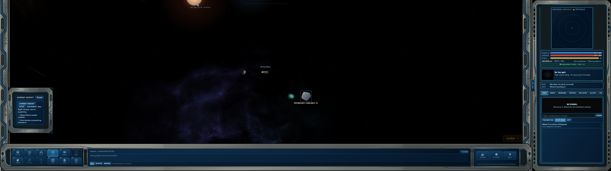
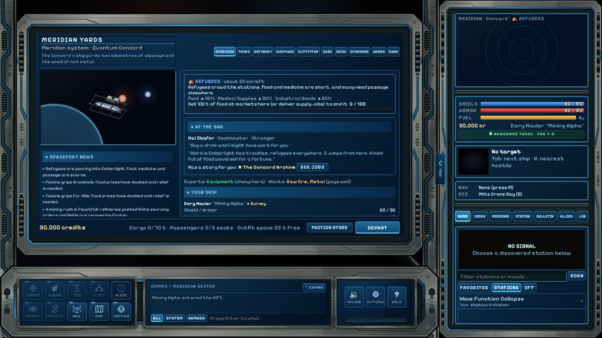
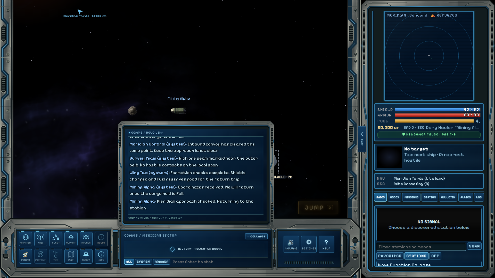
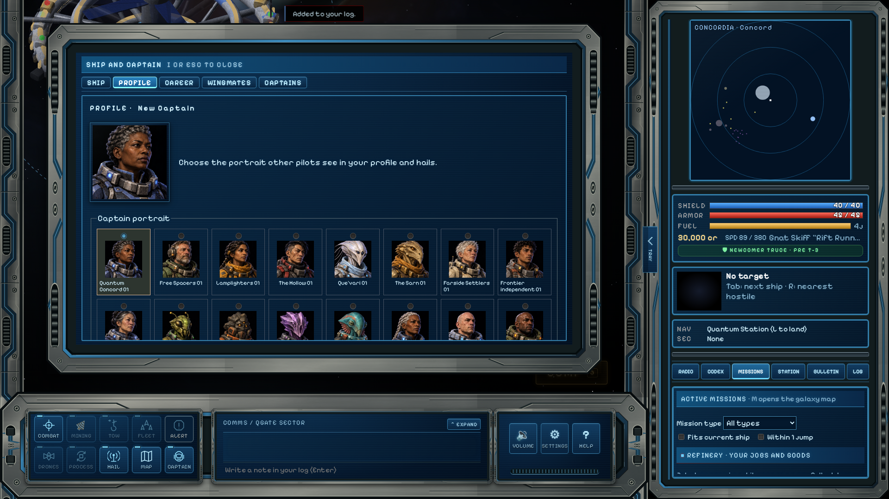
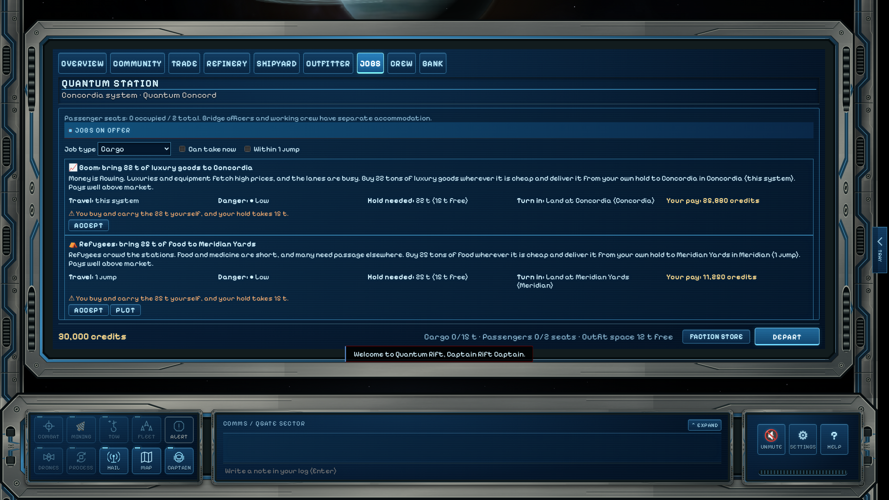

# Quantum Rift

**A space trading and combat game in your browser.**

Fly a ship through a living galaxy of more than 200 star systems. Trade between worlds, take jobs and bounties, mine asteroids, fight pirates, build up a Personal Station, and lead a fleet of crewed wingmates. Play alone, or host a server where friends team up in an Armada.

**Quantum Rift is currently in beta and under ongoing development. All features are subject to change.**

## [Download Quantum Rift](https://github.com/KnightMagnus/quantum-rift/releases/latest/download/Quantum-Rift-latest.zip)

Download the latest release, extract it, and follow the launch instructions below.

## Features

### Explore the galaxy

- Travel between distinctive star systems, rendered planets and stations, from busy trade routes to the remote Eventide frontier. Build your map as you explore, or buy faction star charts to reveal more systems and markets.
- Meet traders, convoys, patrols, pirates and rival captains with their own personalities and careers.
- Visit illustrated worlds and see colonies grow through three settlement stages.
- Discover new places and follow faction stories and spaceport questlines. Your captain's choices shape the main story.
- Hail passing ships for conversation, assistance and encounters. Incoming calls wait until you choose to answer.

### Trade, mine and take jobs

- Trade on markets shaped by shortages, local events and what captains buy and sell.
- Earn your way through deliveries, passenger runs, bounties, patrols, rescues and smuggling. Compare travel, room needed, danger and your payout before choosing a job. Passenger relief runs show where to collect passengers before their destination.
- Mine asteroid, gas and crystal fields; survey deposits, refine your haul and tow large finds home with specialized equipment.
- Follow faction and Syndicate careers, earn standing for specialized faction equipment, develop colonies, earn combat ratings and climb the leaderboards.

### Fly and fight

- Choose from a wide range of ships, including specialty vessels, with guns, beams, missiles, point defense and drones.
- Master momentum-based flight or use optional combat assist. Autopilot handles landing and plotted jump routes. Use **J** or the on-screen **JUMP** button to follow a plotted route. Press **L** to land at a selected world or mission destination, or the nearest port when neither is selected.
- Face enemies that retreat, call for help or bring capital-ship firepower. Friendly fire has consequences.

### Build a station and crew

- Turn a derelict hull into your own **Personal Station**, with a Workshop, research, shipbuilding and defenses. Upgrade it or relocate to another hull. Your own station grants you docking clearance even when the local faction is hostile; visitors use a guest dock without access to your private station services.
- Store ships in your hangar and organize docks around a lead ship and crewed wingmates that fly in formation and follow orders.
- Hire and promote officers for your bridge and fleet, then defend your station in Holdout battles.

### Play with friends

- Form an **Armada** to travel together, share bounties and take on co-op contracts and station defenses. Review team-contract shares and choose Ready before joining.
- Keep in touch through friends lists, private messages, local chat and player hails, with privacy and blocking controls.
- Trade credits, cargo and crafting supplies between captains.
- Choose your PvP: consensual duels or rated team matches in the **Crucible** arena, rather than open-world player hunting.

### Play your way

- Solo mode includes pause, save slots and save-file import and export. A newcomer truce limits ambient hostility while you establish your station; missions and deliberate aggression can still lead to combat.
- Remap controls, adjust interface scale, use a colour-blind palette, or play with a gamepad or touch controls.
- Choose a captain portrait under **Captain → Profile** while flying or landed. Your face appears in public profiles and player hails.
- Resize the Tray and tabbed menu to suit your screen; the system radar stays square. Keep browsing positions and filters, and pin one next objective without hiding your other missions.
- Discover radio stations through exploration and special jobs.

## Start playing

You need a modern browser. The computer running a downloaded game also needs Node.js 22.18 or newer and a [compatible system](docs/TYPESCRIPT-RUNTIME.md#install-the-local-runtime). The launcher downloads the game’s required runtime on first launch, so connect to the internet for that step. Friends joining your game only need a browser.

With Node.js installed, open the extracted game folder:

- **Windows:** double-click **`Start Solo Game.bat`** for a private game, or **`Start Friend Game.bat`** to host friends.
- **macOS / Linux:** open a terminal in the extracted folder and run `sh start-solo.command` for a private game, or `sh start-friends.command` to host friends.

Open **http://localhost:8080** if the browser does not open automatically. Keep the server window open while playing. Solo games accept connections only from your computer; for multiplayer on the same network, friends open `http://<host-computer-address>:8080`. Each player uses a different captain name and their own password. See the [friend-host guide](docs/HOSTING.md) for inviting players and keeping backups.

When updating, close the old game server window first. Preserve your `data/`, `solo-data/` and `friend-data/` save folders; do not replace them with empty folders from a new copy. Solo and friend games keep separate progress; saves do not automatically transfer between modes. Save imports remain Solo-only. If the game asks you to refresh after an update, choose **Refresh Game Page**; if it still cannot connect, check that the host has updated too. See [connection compatibility](docs/PROTOCOL-COMPATIBILITY.md).

## Guides

- [Runtime requirements and building from source](docs/TYPESCRIPT-RUNTIME.md)
- [Hosting a game for friends](docs/HOSTING.md)
- [Dedicated server setup](docs/NAKAMA.md)
- [Beta Solo save generator](test/Save%20Generator/README.md)
- [Support diagnostics](docs/DIAGNOSTICS.md)
- [Development tools](docs/DEVELOPMENT-TOOLS.md) and [code navigation](docs/CODE-NAVIGATION.md)
- [Release notes](docs/RELEASE-0.3.6.2.md)

## Screenshots

**Captain login**

**Flight cockpit and system radar**

The blue Pressure Hull cockpit is the standard interface for flight, station services and chat. The system radar always stays square and follows the Tray width. On short screens, scroll the Tray to reach the lower panels. The tabbed menu keeps its own height divider.

**Flight controls**

Ship-function controls open above the console. INFO shows ship details; EJECT opens the quit menu. JUMP can sit in either bottom corner.

**Landed services**

**Expanded chat**

**Captain profile**

**Job board**

