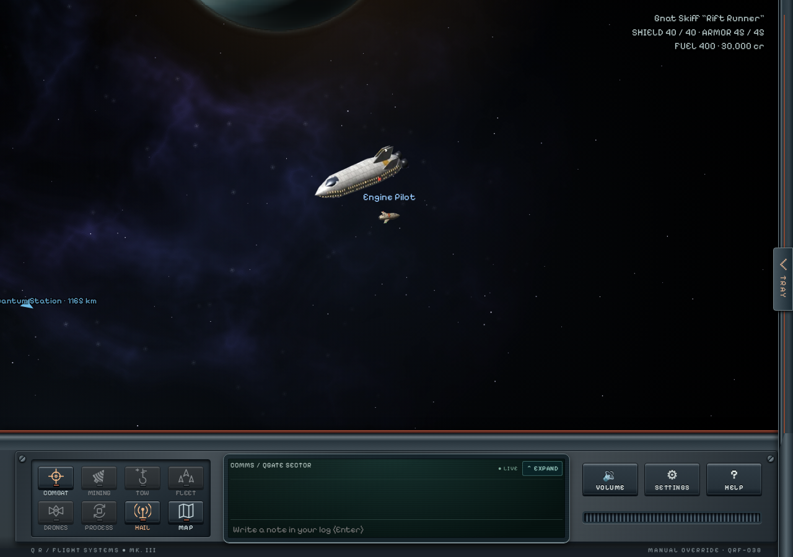

# Quantum Rift

**Quantum Rift is currently in beta and under ongoing development. All features are subject to change.**

## [Download Quantum Rift](https://github.com/KnightMagnus/quantum-rift/releases/latest/download/Quantum-Rift-latest.zip)

**A space trading and combat game in your browser.**

3.3.2 adds a friend-hosted universe alongside local Solo and dedicated online
play. The flight viewport uses ExcaliburJS, and dedicated online authority runs
inside Nakama 3.41.0 with PostgreSQL. See the [release notes](docs/RELEASE-3.3.2.md),
[friend-hosting guide](docs/HOSTING.md) and [dedicated hosting guide](docs/NAKAMA.md).
Solo and friend games need no Nakama or PostgreSQL service. Dedicated hosting
requires operator configuration; the download does not deploy those services.

Fly a ship through a living galaxy of more than 200 star systems. Trade between worlds, take jobs and bounties, mine asteroids, fight pirates, build up a Personal Station, and lead a fleet of crewed wingmates. Play alone, or host a server where friends team up in an Armada.

The flight viewport uses [ExcaliburJS](https://excaliburjs.com/) for its scene,
camera, input and native sprite entities. The shared game simulation and HTML cockpit remain in place; engine scripts are
included locally. Dedicated online authority runs inside Nakama. Friend games run
one authoritative server on the host’s computer; Solo retains its separate local database.

## Features

### Explore the galaxy

- Travel between distinctive star systems, rendered planets and stations, from busy trade routes to the remote Eventide frontier.
- Meet traders, convoys, patrols, pirates and rival captains with their own personalities and careers.
- Discover faction stories, spaceport questlines and a main story hidden in the Rift.
- Hail passing ships for conversation, assistance and encounters. Incoming calls wait until you choose to answer.

### Trade, mine and take jobs

- Trade on markets shaped by shortages, local events and what captains buy and sell.
- See the expected cost or sale value before trading, keep a compact trip recap, and start refining from a plain-language cost-and-output summary.
- Earn your way through deliveries, passenger runs, bounties, patrols, rescues and smuggling. Compare travel, room needed, danger and your payout before choosing a job.
- Mine asteroid, gas and crystal fields; survey deposits, refine your haul and tow large finds home with specialized equipment.
- Follow faction and Syndicate careers, develop colonies, earn combat ratings and climb the leaderboards.

### Fly and fight

- Choose from a wide range of ships, including specialty vessels, with guns, beams, missiles, point defense and drones.
- Master momentum-based flight or use optional combat assist. Autopilot handles landing and plotted jump routes.
- Face enemies that retreat, call for help or bring capital-ship firepower. Friendly fire has consequences.

### Build a station and crew

- Turn a derelict hull into your own **Personal Station**, with refining, research, shipbuilding and defenses. Upgrade it or relocate to another hull.
- Store ships in your hangar and organize docks around a lead ship and crewed wingmates that fly in formation and follow orders.
- Hire and promote officers for your bridge and fleet, then defend your station in Holdout battles.

### Play with friends

- Form an **Armada** to travel together, share bounties and take on co-op contracts and station defenses. Review team-contract shares and choose Ready before joining.
- Keep in touch through friends lists, private messages, local chat and player hails, with privacy and blocking controls.
- Expand chat into a holographic history screen above the cockpit without leaving the flight view.
- Trade credits, cargo and crafting supplies between captains.
- Choose your PvP: consensual duels or rated team matches in the **Crucible** arena, rather than open-world player hunting.

### Play your way

- Solo mode includes pause, save slots and save-file import and export. A newcomer truce limits ambient hostility while you establish your station; missions and deliberate aggression can still lead to combat.
- Remap controls, adjust interface scale, use a colour-blind palette, or play with a gamepad or touch controls.
- Resize the Tray, minimap and tabbed menu to suit your screen. Keep browsing positions and filters, and pin one next objective without hiding your other missions.
- Login music starts on page load when your browser allows autoplay; otherwise it starts on your first interaction. Saved mute and music levels still apply.
- Buy from the local Faction Store while landed in faction space, or visit every faction’s store at your own Personal Station. The store shows your standing with the selected faction and updates it after purchases.
- Login music starts on page load when your browser allows autoplay; otherwise it starts on your first interaction. Saved mute and music levels still apply.
- Discover five radio stations through exploration and special jobs, with 32 owner-supplied songs and a full-album Spacepop tour reward. Stations shuffle their music except the Super-Idol album, which plays in order.
- Run locally in your browser with the project’s pinned Node.js runtime. Built releases need no package installation or compilation.

## Requirements

The computer running the game needs the **pinned Node 27 prerelease** and a modern browser. Run `node tools/runtime/install-node.ts` once with an existing Node installation to install the runtime locally without changing system Node. Built release archives need no npm dependencies or compiler; source checkouts require `npm ci` and `npm run build`. See [runtime and build instructions](docs/TYPESCRIPT-RUNTIME.md) for supported platforms. Friends joining your server only need a browser.

## Launch the published archive

Download and extract the release above, then:

- **Windows:** double-click **`Start Solo Game.bat`** for a private game, or **`Start Friend Game.bat`** to host friends.
- **macOS / Linux:** open a terminal in the extracted folder and run `sh start-solo.command` for a private game, or `sh start-friends.command` to host friends.
- **Any platform, from a terminal:** run `node tools/start.ts --friends` to host friends. Ordinary `node tools/start.ts` selects dedicated online hosting and requires separately configured Nakama and PostgreSQL.

Open **http://localhost:8080** if the browser does not open automatically. Keep the server window open while playing. Solo games accept connections only from your computer; for multiplayer on the same network, friends open `http://<host-computer-address>:8080`.

When updating, close the old game server window first. Preserve your `data/` and
`solo-data/` and `friend-data/` save folders; do not replace them with empty folders from a new copy.

## Run this source checkout

After installing the pinned Node runtime, run `npm ci` and `npm run build`.
Choose how to play:

| Mode             | Start                                                               | Where progress lives                             |
| ---------------- | ------------------------------------------------------------------- | ------------------------------------------------ |
| Solo             | `Start Solo Game.bat` or `sh start-solo.command`                    | Local Solo saves, with pause and import/export   |
| Host friends     | `Start Friend Game.bat` or `sh start-friends.command`               | One shared universe in the host’s `friend-data/` |
| Dedicated online | `node tools/start.ts`, with separately configured Nakama/PostgreSQL | Native server storage                            |

The friend launcher opens the host’s browser and explicitly enables LAN listening.
Keep its server window open. The host plays in the same browser game as everyone
else; friends open the host’s LAN or VPN URL, not `localhost`. Each player uses a
different captain name and their own password. The login status identifies a
friend-hosted universe. Friend games have no Solo pause or save import/export and
start without demo accounts. See [the friend-host guide](docs/HOSTING.md) for
addresses, binding, backups and Internet access limits.

Ordinary startup still selects the dedicated native backend: it starts only the
static web host, not Nakama or PostgreSQL. Configure those services separately
using [NAKAMA.md](docs/NAKAMA.md). Neither startup route opens router ports or
changes firewall rules automatically.

Preserve `friend-data/`, `data/` and `solo-data/` when changing checkouts. These
stores do not automatically import or synchronize with each other. For custom
Solo test captains, use the [save generator](test/Save%20Generator/README.md).
Save imports remain Solo-only.

## Screenshots

**Flight cockpit**

**Expanded chat projection**

**System radar and sidebar**

**Landed services**

**Galaxy map**

**Discoverable radio stations**

**Local faction store**

