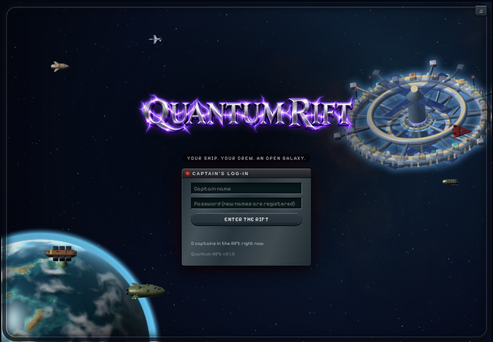
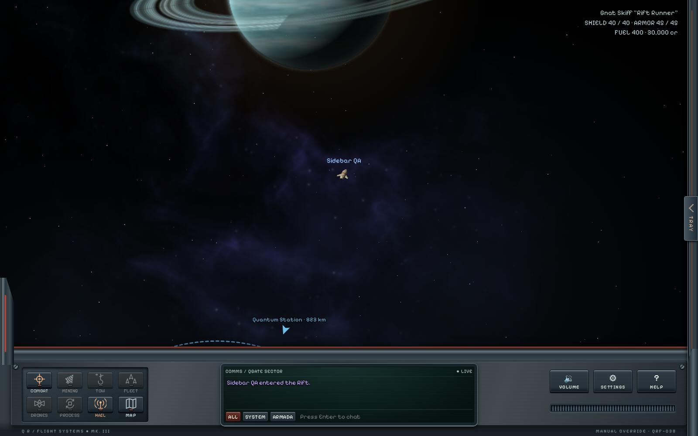
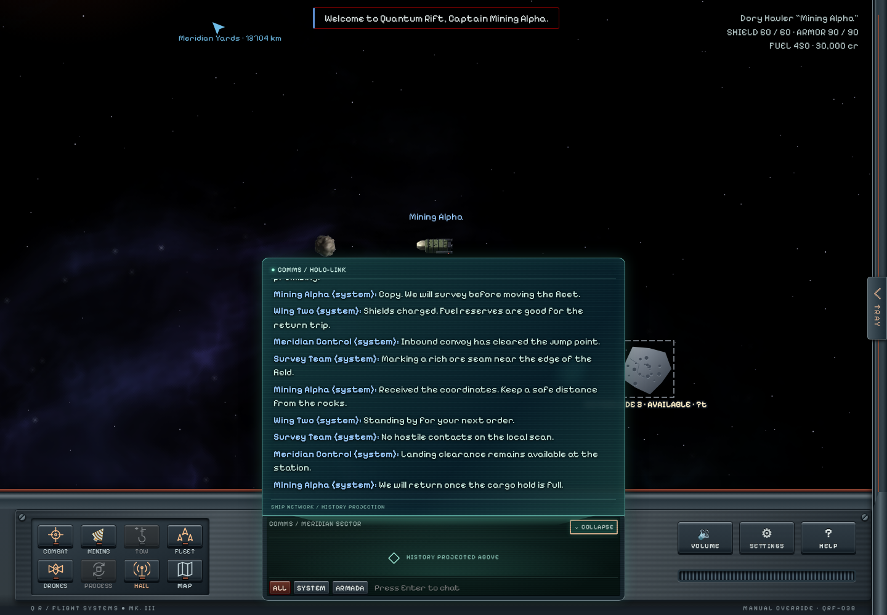
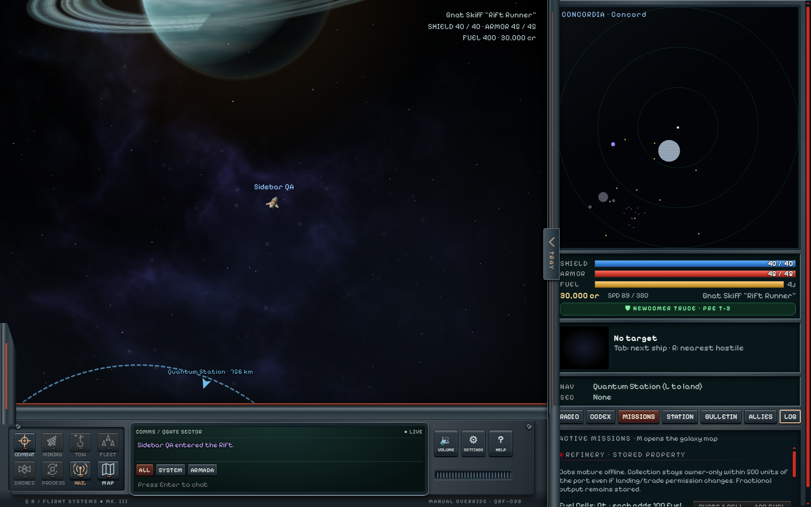
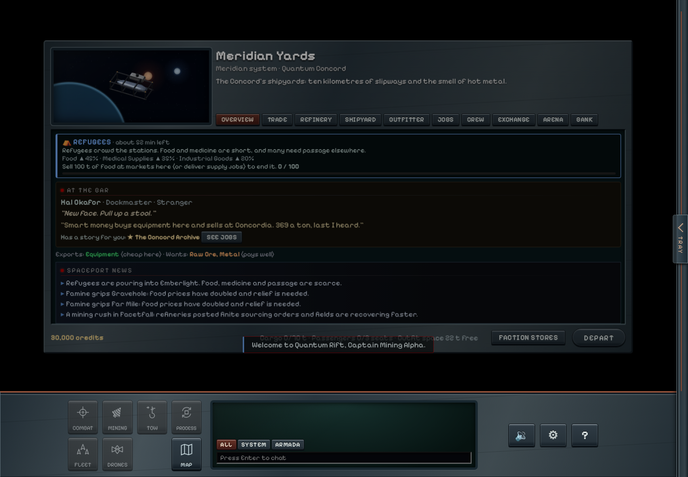
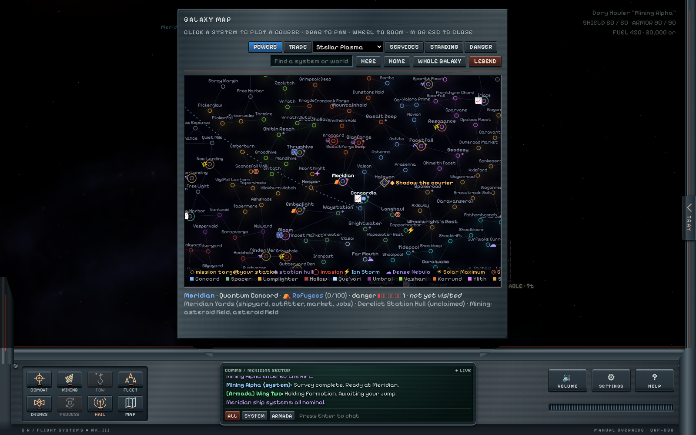

# Quantum Rift

**Quantum Rift is currently in beta and under ongoing development. All features are subject to change.**

## [Download Quantum Rift](https://github.com/KnightMagnus/quantum-rift/releases/latest/download/Quantum-Rift-latest.zip)

**A space trading and combat game in your browser.**

3.3.1 is a maintenance release: clearer server ownership, organized stylesheets,
and a [developer code-navigation guide](docs/CODE-NAVIGATION.md). Gameplay and
save formats are unchanged by the cleanup. See the [release notes](docs/RELEASE-3.3.1.md).

Fly a ship through a living galaxy of more than 200 star systems. Trade between worlds, take jobs and bounties, mine asteroids, fight pirates, build up a Personal Station, and lead a fleet of crewed wingmates. Play alone, or host a server where friends team up in an Armada.

## Features

### Explore the galaxy

- Travel between distinctive star systems, rendered planets and stations, from busy trade routes to the remote Eventide frontier.
- Meet traders, convoys, patrols, pirates and rival captains with their own personalities and careers.
- Discover faction stories, spaceport questlines and a main story hidden in the Rift.
- Hail passing ships for conversation, assistance and encounters. Incoming calls wait until you choose to answer.

### Trade, mine and take jobs

- Trade on markets shaped by shortages, local events and what captains buy and sell.
- See the expected cost or sale value before trading, keep a compact trip recap, and start refining from a plain-language cost-and-output summary.
- Earn your way through deliveries, passenger runs, bounties, patrols, rescues and smuggling. Compare travel, room needed, danger and your payout before choosing a job.
- Mine asteroid, gas and crystal fields; survey deposits, refine your haul and tow large finds home with specialized equipment.
- Follow faction and Syndicate careers, develop colonies, earn combat ratings and climb the leaderboards.

### Fly and fight

- Choose from a wide range of ships, including specialty vessels, with guns, beams, missiles, point defense and drones.
- Master momentum-based flight or use optional combat assist. Autopilot handles landing and plotted jump routes.
- Face enemies that retreat, call for help or bring capital-ship firepower. Friendly fire has consequences.

### Build a station and crew

- Turn a derelict hull into your own **Personal Station**, with refining, research, shipbuilding and defenses. Upgrade it or relocate to another hull.
- Store ships in your hangar and organize docks around a lead ship and crewed wingmates that fly in formation and follow orders.
- Hire and promote officers for your bridge and fleet, then defend your station in Holdout battles.

### Play with friends

- Form an **Armada** to travel together, share bounties and take on co-op contracts and station defenses. Review team-contract shares and choose Ready before joining.
- Keep in touch through friends lists, private messages, local chat and player hails, with privacy and blocking controls.
- Expand chat into a holographic history screen above the cockpit without leaving the flight view.
- Trade credits, cargo and crafting supplies between captains.
- Choose your PvP: consensual duels or rated team matches in the **Crucible** arena, rather than open-world player hunting.

### Play your way

- Solo mode includes pause, save slots and save-file import and export. A newcomer truce limits ambient hostility while you establish your station; missions and deliberate aggression can still lead to combat.
- Remap controls, adjust interface scale, use a colour-blind palette, or play with a gamepad or touch controls.
- Resize the Tray, minimap and tabbed menu to suit your screen. Keep browsing positions and filters, and pin one next objective without hiding your other missions.
- Discover five radio stations through exploration and special jobs, with 32 owner-supplied songs and a full-album Spacepop tour reward. Stations shuffle their music except the Super-Idol album, which plays in order.
- Run locally in your browser with Node.js—no package installation or build step required.

## Requirements

The computer running the game needs **[Node.js](https://nodejs.org) 18 or newer** and a modern browser. No package installation or build step is needed. Friends joining your server only need a browser.

## Launch

Download and extract the release above, then:

- **Windows:** double-click **`Start Solo Game.bat`** for a private game, or **`Start Quantum Rift.bat`** to host multiplayer.
- **macOS / Linux:** open a terminal in the extracted folder and run `sh start-solo.command` for a private game, or `sh start.command` to host multiplayer.
- **Any platform, from a terminal:** run `node server/main.js` in the extracted folder to host multiplayer.

Open **http://localhost:8080** if the browser does not open automatically. Keep the server window open while playing. Solo games accept connections only from your computer; for multiplayer on the same network, friends open `http://<host-computer-address>:8080`.

When updating, close the old game server window first. Preserve your `data/` and
`solo-data/` save folders; do not replace them with empty folders from a new copy.

For custom Solo test captains, use the [save generator](Testing/SaveGenerator/README.md). Save imports are not available online.

## Screenshots

**Flight cockpit**

**Expanded chat projection**

**System radar and sidebar**

**Landed services**

**Galaxy map**

**Discoverable radio stations**

