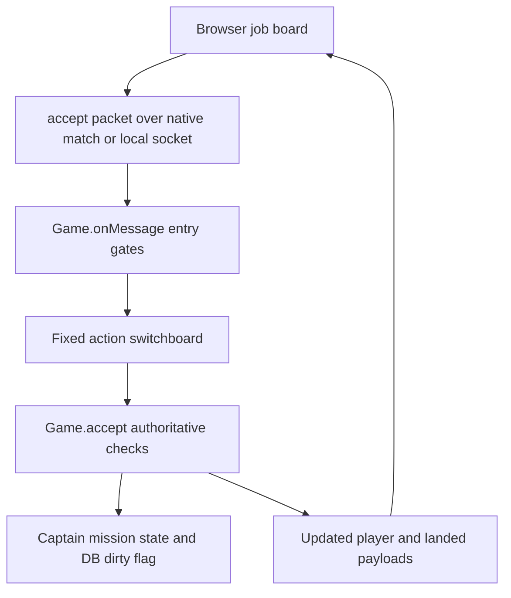

# Code navigation

Start here to find a feature, trace a player action, or decide where a change
belongs. This maps existing code; it does not claim every subsystem is independent
or fully typed. For running the game, use the public README.

## Entry points

1. Read `package.json` for startup, test commands and the current version.
2. Read [server/main.ts](../server/main.ts): default dedicated startup selects the static
   [Nakama web host](../server/nakama-host.ts); Solo and explicit `HOST_FRIENDS=1`
   select [the local platform](../server/local-main.ts). The dedicated web host has no Game,
   database or gameplay WebSocket.
3. Follow [the native match](../server/nakama-world.ts) into
   [Game](../server/game.ts)'s constructor: live systems, sessions, named feature
   services and fixed message routes. Nakama advances online simulation; the local
   platform owns the Solo or friend-game timer. Friend mode has one Game and local
   journal store, not a second Nakama clock. See [hosting choices](HOSTING.md)
   and [native hosting](NAKAMA.md).
4. Read [FEATURES.md](FEATURES.md) before changing composition. Its explicit
   service boundaries and remaining shared state are migration seams.
5. Follow one action below rather than reading every large file front to back.

## Directory map

| Location  | Responsibility                                                                                                        |
| --------- | --------------------------------------------------------------------------------------------------------------------- |
| `client/` | Browser input, rendering, panels, layout and local presentation state.                                                |
| `server/` | Authoritative multiplayer actions, sessions, simulation and saving.                                                   |
| `shared/` | Catalogs, authored content and common calculations. Shared browser access does not grant authority to award anything. |
| `test/`   | Behavior checks, deterministic fixtures and registered CI runners.                                                    |
| `docs/`   | System contracts, guides, design limits and fixture provenance.                                                       |
| `tools/`  | Developer/reporting/asset tools, not the live game loop.                                                              |

The beta-only [Solo save generator](../test/Save%20Generator/README.md) lives in
`test/Save Generator/`. Its catalog, import regressions and Windows EXE build must
stay compatible with each release while the tool is present.

## Trace a player action: accept a cargo job



1. [client/ui.ts](../client/ui.ts) builds the board and sends the action;
   [client/mission-details.ts](../client/mission-details.ts) explains requirements
   and [client/missions.ts](../client/missions.ts) manages mission presentation.
2. [client/connection.ts](../client/connection.ts) sends online actions through the
   native SDK. [server/nakama-world.ts](../server/nakama-world.ts) resolves the
   authenticated captain, bounds match ingress and passes actions to `Game.onMessage`.
   Solo and friend games use the local platform’s WebSocket and `Game.connect`
   listener. Friend games retain password login; Solo does not.
3. [server/game.ts](../server/game.ts)'s `onMessage` applies flood, login,
   checkpoint-recovery freeze and activity gates **before** routing.
4. [server/game-message-handlers.ts](../server/game-message-handlers.ts) maps
   `accept` to the core method. It is the action switchboard, not a separate
   reward or permission authority.
5. `Game.accept` forwards to [server/jobs.ts](../server/jobs.ts), the ordinary
   job owner. It checks the current offer, job limits and real hold/bunk space,
   then records the accepted contract. `Game.offers` forwards to the same job service;
   [server/freight-offers.ts](../server/freight-offers.ts) supplies the stable freight tiers.
   `Game.completeOnLanding` forwards ordinary landing completion to that owner; special mission
   progression also lives in named quest/co-op providers.
6. `you` and `landed` send refreshed payloads.
   [Nakama storage](../server/nakama-storage.ts) owns the atomic online checkpoint;
   [the local DB](../server/db.ts) retains separate Solo/friend persistence. Sending a refresh is
   not itself a save commit.

For other actions, find the outgoing packet's `t`, look it up in the fixed
switchboard, then follow the named method/service. Native joins establish the
server-owned identity before the internal Game hello; client hello packets cannot
choose a captain. Solo/friend/reference hello uses the existing pre-login entry
gate, not the authenticated route registry.

Useful searches from the repository root:

```sh
rg -n "'accept'|accept\(s|completeOnLanding" client server
rg -n 'createMessageHandlers|onMessage\(s' server/game.ts
rg -n "'trade'|'refinery'" server/game-message-handlers.ts
rg -n 'cargo-courier-progression|robustness-wiring' test/regression-manifest.json
```

## Find the right subsystem

| Change                                          | Start with                                                  | Important companions                                                                                         |
| ----------------------------------------------- | ----------------------------------------------------------- | ------------------------------------------------------------------------------------------------------------ |
| Performance and operational diagnostics         | `shared/health.ts`, `docs/PERFORMANCE.md`                   | `tools/performance-baseline.ts`, `tools/performance-native.ts`, matching `test/helpers/` harnesses           |
| Opt-in support captures and offline replay      | `shared/diagnostic-capture.ts`, `docs/DIAGNOSTICS.md`       | `shared/diagnostic-replay.ts`, `client/diagnostics.ts`, `tools/replay-diagnostic-capture.ts`                 |
| Startup and static HTTP                         | `server/main.ts`, `server/nakama-host.ts`                   | `tools/start.ts`, `docs/NAKAMA.md`                                                                           |
| Native sessions, match ingress and clock        | `server/nakama-world.ts`, `server/nakama-auth.ts`           | `server/nakama-identity-gates.ts`, `server/nakama-storage.ts`                                                |
| Solo/friend endpoints and reference fixtures    | `server/local-main.ts`                                      | `server/ws.ts`, `server/db.ts`, `server/friend-host-config.ts`                                               |
| Login, sessions, travel, ordinary port services | `server/game.ts`                                            | `server/space.ts`, `shared/galaxy.ts`                                                                        |
| Incoming action names/routing                   | `server/game-message-handlers.ts`                           | `Game.createMessageHandlers`, `Game.onMessage`, `server/message-registry.ts`                                 |
| Feature wiring/dependencies                     | `server/features.ts`                                        | `server/feature-service.ts`, `docs/FEATURES.md`, `docs/feature-inventory.json`                               |
| Flight physics, collisions, system entities     | `server/space.ts`                                           | `server/combat-assist.ts`, `shared/rules.ts`                                                                 |
| Cargo, trading and grades                       | `server/port-services.ts`, `shared/cargo-lots.ts`           | `server/trade-pricing.ts`, `shared/trade-pricing.ts`, `shared/economy-preview.ts`                            |
| Public jobs and hauling                         | `Game.offers/accept/completeOnLanding`                      | `server/freight-offers.ts`, `shared/passengers.ts`, `docs/CARGO-JOBS.md`                                     |
| Story Jobs and quest steps                      | `server/quests.ts`, `shared/quests.ts`                      | `server/story.ts`, `shared/story.ts`, `server/arcs.ts`, `shared/arcs.ts`                                     |
| Team missions/consent                           | `server/coop.ts`                                            | `server/warband-consent.ts`, `shared/mission-payouts.ts`, `docs/MISSION-REWARDS.md`                          |
| Mining/refining/industrial/towing               | Corresponding `server/` provider                            | Matching `*-contracts.js`, `shared/*-rules.js`, browser panels                                               |
| Hails/dialogue                                  | `server/hail-service.ts`, `server/hail-dialogue.ts`         | `server/hail.ts`, `client/hails_ui.ts`, `docs/HAILING.md`                                                    |
| Radio/discovery                                 | `shared/radio-stations.ts`, `server/radio-discovery.ts`     | `client/radio.ts`, `client/audio.ts`, `docs/RADIO.md`                                                        |
| Browser connection/input/loop                   | `client/main.ts`                                            | `client/action-bindings.ts`, travel autopilot modules                                                        |
| Menus/HUD                                       | `client/ui.ts`, `client/style.css`, `client/cockpit.css`    | `client/cockpit-state.ts`, `client/sidebar-size.ts`, `client/chat-projection.ts`, `client/ship-functions.ts` |
| Scene/ship drawing                              | `client/render.ts`                                          | `client/artwork.ts`, animation/ship-banking modules, `client/assets/`                                        |
| Galaxy/hulls/loadouts/stats                     | `shared/galaxy.ts`, `shared/assets.json`, `shared/rules.ts` | Shared bonus/stats owners in `server/features.ts`                                                            |
| Authored ship content checks                    | `tools/content-validation.ts`, `tools/validate-content.ts`  | `test/content-validation.ts`, `docs/CONTENT-VALIDATION.md`                                                   |

## Save compatibility checks

`server/save-migrations.ts` catalogs existing migration owners without changing
live lifecycle order. `tools/save-restore-verify.ts` rehearses only the existing
cargo/storage-ledger migration on disposable local copies. See
[SAVE-MIGRATIONS.md](SAVE-MIGRATIONS.md) for commands and limits. `server/db.ts`
rejects corrupt or unreadable local snapshots instead of silently resetting them;
feature validation and native CAS authority remain with their existing owners.

## Who owns which information?

- **Reusable foundations:** `shared/galaxy-graph.ts` owns ordered link traversal;
  callers choose filters, depth limits and cache lifetimes. Weighted gate-aware
  routing remains a separate policy. `shared/ship-capacity.ts` calculates commodity
  and mission hold allocation without owning inventory or granting permission to
  load cargo. `client/html.ts` preserves the existing escaping policies for HTML
  text and double-quoted attributes; it is not a URL or script sanitizer.
- **TypeScript execution:** application modules use native TypeScript source.
  Node strips erasable types when executing source; browser modules are compiled
  into `dist`. Type stripping is not type checking. See
  [TYPESCRIPT-RUNTIME.md](TYPESCRIPT-RUNTIME.md) for the checked scope and startup
  commands.

- **Persistent accounts/world:** the structural `GameStorage` port selects
  `NakamaDatabase` online and `DB` locally. Ordinary changes mark storage dirty;
  native CAS checkpoints and local journals have explicit commit/recovery rules.
  Preserve these boundaries rather than adding another save path.
- **Friend-host startup and exposure:** `server/friend-host-config.ts` validates
  explicit mode, binding, port, public origin and the separate `friend-data/`
  directory. `tools/start.ts --friends` is the LAN opt-in used by the friend
  launchers. `/api/status` advertises `mode: "friends"` and `localTransport: true`;
  `client/connection.ts` selects the local socket only with that mode pair or
  Solo. The server owns login, world state and the clock; browsers are clients.
- **Live sessions/active systems:** `Game` owns session and live-space maps.
  `Space` advances a system's simulation. Accessing `game.spaces[id]` can lazily
  wake a system: it is not an inert lookup table.
- **Ordinary jobs:** `game.jobService` owns board generation, acceptance and
  landing completion, using the existing account mission array. It has no second
  save store. Story, Armada and mining-order services retain their specialized
  progression; port refresh, logging and shared capacity stay core capabilities.
- **Port commerce:** `game.portService` owns ordinary markets, commodity/material
  settlement, shipyard purchases/trade-in and outfitter operations. Existing Game
  entry points remain, the same account inventories are used, and shared pricing/
  grade helpers retain their arithmetic. Previewing a trade never settles one.
- **Personal Station progress:** `game.stationProgress` advances refinery accrual
  and research completion on the existing captain record. `Game.checkStation`
  remains the entry point used by player refreshes, station actions and idle
  checks. Narrow callbacks resolve the current hangar and log owners at call
  time. Hangar still owns queued research settlement; Game still owns station
  permission checks, idle notifications and storage dirty flags. Progress uses
  wall time without installing another clock or save path.
- **Feature operations:** `game.features.<name>` exposes named services with
  explicit capability facades. Some state still lives on `Game` or in shared
  account/world objects. These are not fully isolated workers.
- **Routes:** `Game.createMessageHandlers` supplies explicit live getters and
  forwarding functions. Routes read current services/state, including replacements
  after construction. Do not snapshot mutable dependencies or bind stale methods.
- **Browser presentation:** panels and local cockpit preferences belong to the
  client. The server still validates and performs any previewed operation.
- **Shared calculations/content:** these supply definitions, not permissions.
  Avoid duplicating authoritative arithmetic in a panel.

See [DEVELOPMENT-TOOLS.md](DEVELOPMENT-TOOLS.md) for lint, formatting and compiler policy.

## Tests and a safe change workflow

1. Find the system/action in
   [test/regression-manifest.json](../test/regression-manifest.json); read its
   tests first. [TEST-COVERAGE.md](TEST-COVERAGE.md) explains scope and omissions.
2. Run focused cases while developing. For routing changes, start with
   `node test/message-routing.ts`, `npm run test:features` and the relevant real
   action/network tests. Fuzzing discovers routes from the runtime registry, not
   source-code switch patterns.
3. Run existing gates:

   ```sh
   npm run lint
   npm run typecheck
   npm run test:features
   npm run test:types
   npm run format:check
   npm run test:regression
   git diff --check
   ```

4. Keep behavior changes separate from moves. Preserve independent baseline
   evidence, operation order, denial cases, saves and late-bound test seams.
   Do not regenerate expected fixtures from a replacement merely to get green.
5. Use temporary saves and fixtures, never a real captain's account. Do not
   include private saves, dependencies or source-audio masters in a PR.

Strict TypeScript checks cover application modules, including action implementations.
The source-coverage guard rejects unchecked application JavaScript and modules
omitted from the compiler project. Static types do not runtime-validate incoming
JSON or prove every branch.

## Action-routing boundary

Economic request shapes live in `shared/wire-actions.ts`; refinery, towing and industrial
services reuse those validators for direct calls as well as transport dispatch.
`shared/refinery-wire.ts` owns refinery payload types without client/server
implementation dependencies. `shared/wire-payloads.ts` bounds economic receive
payloads and validates player/port headers and quote shapes, not every nested
player or offer schema.

Action routing lives in `server/game-message-handlers.ts`; entry gates and service
implementations retain their own owners. Ordinary jobs and port commerce have
separate services. Station timer advancement lives in `server/station-progress.ts`;
station action permissions, settlement and session methods remain in `Game`.
[MESSAGE-ROUTING.md](MESSAGE-ROUTING.md) describes the routing contract and fixtures.

## UI stylesheet ownership and order

`client/style.css` is the ordered stylesheet entry point. Its ten imports keep
their cascade order and the same asset-relative directory:

| File                          | Contents                                                                           |
| ----------------------------- | ---------------------------------------------------------------------------------- |
| `style-foundation.css`        | Palette, native controls, shared menu chrome and base document styling.            |
| `style-flight-hud.css`        | Sidebar, radar, tabs and flight HUD structure.                                     |
| `style-communications.css`    | Original chat, toast and help styling.                                             |
| `style-overlays.css`          | Landing/map/options/dialog overlay foundation.                                     |
| `style-cursors-map.css`       | Custom cursors and galaxy-map tools.                                               |
| `style-companions.css`        | Crew/hangar/boarding and operations components.                                    |
| `style-controls-login.css`    | Touch controls, title/solo/story presentation and accessibility foundations.       |
| `style-port-services.css`     | Mission board, command bar, radio, hail and Syndicate panels.                      |
| `style-late-components.css`   | Later component chrome, newcomer badge, docks, volume, quest and dialog overrides. |
| `style-responsive-scenes.css` | Later responsive/sidebar, login/co-op, communication and mining-layout rules.      |

The last two files contain cross-component overrides and duplicate selectors. Do not regroup selectors or reorder imports without checking their
cascade and responsive behavior. The separate `cockpit.css` and `login_scene.css`
keep their existing document positions. No preprocessor or bundler is required.

## Flight engine

Excalibur 0.32.0 owns the browser flight clock in `client/engine.ts` and the
persistent `SpaceScene` in `client/space-scene.ts`. `client/main.ts` still owns
networking, the original DT accumulator/prediction and DOM command routing.
`client/engine-input.ts` reads physical keys through Excalibur and queues short
presses until a simulation tick. Typing and modal controls keep their DOM behavior.

`client/world-actors.ts` reconciles display-only Actors and native Sprite graphics
for ships, rocks, loot and projectiles. Actors never receive authoritative
velocities, collisions or ownership of gameplay. Authored hull heading/bank frames
and thruster masks remain in use. Procedural scenery, beams, links and overlays
use ordered screen-space Canvas Graphics below, between and above native entities.
Effect lifetimes and motion advance in `updateEffects`, not in those draw callbacks.

The engine camera projects world entities and resolves pointer coordinates.
Resolution deliberately uses CSS size times DPR with engine pixelRatio 1, retaining
the existing physical-pixel zoom. Picking subtracts visual shake. Radar/map/login
remain separate presentation canvases; login artwork shares the engine clock.
Software WebGL drivers select the supported Canvas backend before Engine construction.
`?renderer=canvas` or `?renderer=webgl` explicitly selects either backend without
replacing the live canvas. Canvas uses normal alpha compositing for native glow;
WebGL uses an additive material.

The browser build bundles the engine dependency graph into `dist/client/engine.js`.
Existing stateful audio/HUD/render helpers remain local modules with one shared
instance, including when browser tests import them. Releases need no CDN or
node_modules at runtime. Procedural full-viewport Graphics rasterize at up to 30Hz;
native entities and simulation retain the Engine update cadence. These layers remain
a rendering cost, not evidence of a general performance improvement.

## Private cockpit attention

`server/attention.ts` projects live weapon-target selection and the last patrol scan into recipient-only booleans. `Game.tick` attaches them inside each flying captain's own snapshot; shared `Space.snapshot` and docked scenes do not publish those flags or new target identities. The real patrol action in `FrontsOperations.missionIdle` records one transient three-second recent-scan notification, never saved data. The browser shows combat red before recent-scan orange; reduced-motion mode retains color without blinking. Auto-combat reads its actual combatTarget, not the UI selection; existing rules still forbid auto-combat targeting player-root ships.

### Sidebar sizing and landing notices

`client/sidebar-size.ts` owns device-local desired heights under
`rift.hudHeights`. It allocates the lower menu and minimap against measured sidebar
chrome, preserving desired values when the viewport temporarily clamps them.
`client/ui.ts` renders expanded and collapsed gauges from the same player/view
state. Connection teardown clears the collapsed readout before another snapshot.

`client/landing-feedback.ts` owns only landing-notice suppression. `landRequest`
selects a semantic situation and retains an already active approach; authoritative
landing refusals release the approach without resetting that situation. Manual
cancellation, session changes and a new situation allow a fresh notification.

### Login playback and decorative traffic

`client/audio.ts` owns the login source and exposes its loop-relative context time.
`client/login-traffic.ts` uses that position and decoded duration for a deterministic,
bounded schedule of actual catalog hulls; it creates no physics entities or clock.
`client/login_scene.ts` paints those positions from the existing engine update and
retains its visibility and reduced-motion lifecycle. Source replacement resets the
playback epoch, while an ordinary score loop reuses the source.

`tools/rift_purchase_audio.py` writes the original short purchase signal using only
standard-library oscillators and envelopes. `tools/rift_audio.py` delegates to it,
so regenerating the broad sound library does not restore the retired sharp jingle.

## Modal and manual-input ownership

`client/overlay-controller.ts` owns priority, keyboard capture, native Tab wrapping
and focus return for confirmation, quit, boarding, Options, Controls, map, ship/captain info, hails,
story, storage and ship-loss dialogs.
Their existing owners still render content and decide whether an action is
allowed. Confirmation sits above quit; Controls and Options retain their existing
visual priorities below quit and above boarding. Enter and Space activate the
focused native button; Cancel receives initial focus in confirmation and quit,
and Close in Options and Controls. Logout drops pending callbacks, binding capture
and focus references.

Options owns rebinding and saved settings. Its policy handles pending key capture
before default Escape dismissal: the first Escape cancels capture without closing
Options. The controller otherwise leaves native settings controls and button
activation intact. Rebuilding binding rows returns focus to the same action.
Controls owns its reference content and Change Keys transition into Options.
If a closing dialog cannot return focus to its opener, the surviving managed
dialog receives its initial focus. The map receives container focus; map search keeps Enter selection and uses the
first Escape to leave the search field. The next Escape closes the map.

The controller's DOM-derived blocking context is passed into the engine input
latch rather than importing another controller instance into the engine bundle.
Keyboard, canvas/radar pointer, touch and gamepad manual controls use that same
context. Held keys and gamepad controls must release before resuming. Existing
navigation can continue while a dialog is open; opening a dialog does not pause
the shared world. Solo quit keeps its existing temporary pause behavior.

Story offers initially focus the defer button; Escape never accepts a choice or
reward. Story notices and ship-loss notices focus Continue. Hails initially focus
Close and retain native message typing and Enter submission. Priority follows the
existing visual stack, including hails above ship/captain info. Map help and Options
openers remain available outside the map; other outside clicks cannot activate
underlying commands. Storage loss of availability closes through the same owner.

Login remains the session gate, not a dismissible game dialog. The landing screen
is not a flight-blocking modal in this context; its existing docked-state gates
remain authoritative. Mining retains its additional landed-state denial.

## Release gates

[RELEASE-READINESS.md](RELEASE-READINESS.md) describes the aggregate, immutable
archive matrix and rollback limits. `tools/release-readiness.ts` owns fail-closed
lane evaluation; `tools/verify_archive.py` owns hash/inventory checks before
extraction. `test/release-archive-smoke.ts` runs the built artifact without npm
dependencies. Existing quality/server/browser/Windows check names remain intact.

## Viewscreen fit and non-human contacts

`client/cockpit.css` sizes ultrawide landed windows against the usable flight
area, excluding the persistent Tray and console; child UI zoom does not enlarge
them into those regions. Cockpit content starts inside the frame fastener gutter.
Controls keeps key/description pairs together in two columns, falling back to one
column when its own content area is narrow.

`shared/hail-machine.ts` identifies ship-only Index and Nhal callers. The existing
hail service retains the hull identity for incoming calls and archived messages;
`client/hails_ui.ts` selects only trusted ship artwork for them, including failure
fallbacks. `server/index-fleet.ts` gives neutral machines stable saved-roster
berths sized for the largest deployed hull posture and separates overlapping
neutral hull envelopes after movement. Combat, damage attribution and finite
replacement/reward owners remain unchanged.

`client/ui.ts` excludes the unique story harness from both Codex lists and detail
navigation. The outfit definition, story rewards, fitting and owned inventory
remain available to their existing gameplay owners.

## Client/server compatibility

[shared/protocol.ts](../shared/protocol.ts) owns the wire epoch and explicit legacy
policy. [client/connection.ts](../client/connection.ts) checks fresh HTTP status and
the native world RPC before joining. Local Game hello and native join metadata
are checked before Game login. [PROTOCOL-COMPATIBILITY.md](PROTOCOL-COMPATIBILITY.md)
describes supported combinations and update recovery.
