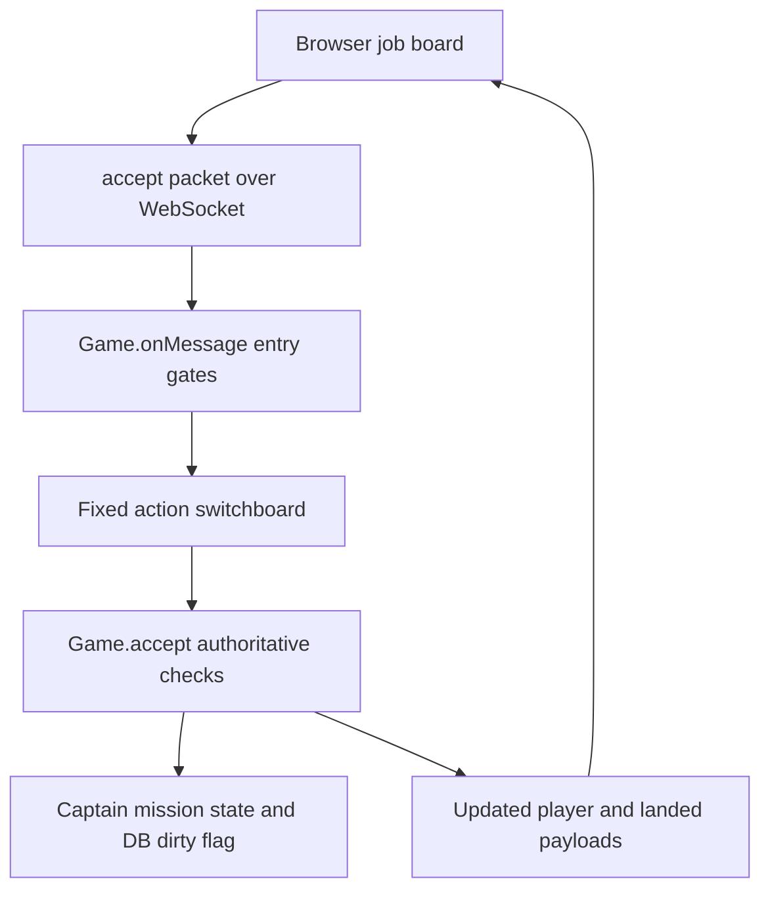

# Code navigation

Start here to find a feature, trace a player action, or decide where a change
belongs. This maps existing code; it does not claim every subsystem is independent
or fully typed. For running the game, use the public README.

## Entry points

1. Read `package.json` for startup, test commands and the current version.
2. Read [server/main.ts](../server/main.ts): it loads assets and the DB, creates
   `Game`, serves files and connects WebSockets.
3. Follow [Game](../server/game.ts)'s constructor: live systems, sessions, named
   feature services, combat/hailing services, fixed message routes and tick loop.
4. Read [FEATURES.md](FEATURES.md) before changing composition. Its explicit
   service boundaries and remaining shared state are migration seams.
5. Follow one action below rather than reading every large file front to back.

## Directory map

| Location  | Responsibility                                                                                                        |
| --------- | --------------------------------------------------------------------------------------------------------------------- |
| `client/` | Browser input, rendering, panels, layout and local presentation state.                                                |
| `server/` | Authoritative multiplayer actions, sessions, simulation and saving.                                                   |
| `shared/` | Catalogs, authored content and common calculations. Shared browser access does not grant authority to award anything. |
| `test/`   | Behavior checks, deterministic fixtures and registered CI runners.                                                    |
| `docs/`   | System contracts, guides, design limits and fixture provenance.                                                       |
| `tools/`  | Developer/reporting/asset tools, not the live game loop.                                                              |

The beta-only [Solo save generator](../Testing/SaveGenerator/README.md) lives in
`Testing/SaveGenerator/`. Its catalog, import regressions and Windows EXE build must
stay compatible with each release while the tool is present.

## Trace a player action: accept a cargo job



1. [client/ui.ts](../client/ui.ts) builds the board and sends the action;
   [client/mission-details.ts](../client/mission-details.ts) explains requirements
   and [client/missions.ts](../client/missions.ts) manages mission presentation.
2. [server/main.ts](../server/main.ts) upgrades the WebSocket and calls
   `Game.connect`; that session listener parses messages and calls `Game.onMessage`.
3. [server/game.ts](../server/game.ts)'s `onMessage` applies flood, login,
   checkpoint-recovery freeze and activity gates **before** routing.
4. [server/game-message-handlers.ts](../server/game-message-handlers.ts) maps
   `accept` to the core method. It is the action switchboard, not a separate
   reward or permission authority.
5. `Game.accept` forwards to [server/jobs.ts](../server/jobs.ts), the ordinary
   job owner. It checks the current offer, job limits and real hold/bunk space,
   then records the accepted contract. `Game.offers` forwards to the same job service;
   [server/freight-offers.ts](../server/freight-offers.ts) supplies the stable freight tiers.
   `Game.completeOnLanding` forwards ordinary landing completion to that owner; special mission
   progression also lives in named quest/co-op providers.
6. `you` and `landed` send refreshed payloads. [server/db.ts](../server/db.ts)
   owns persistence; sending a refresh is not itself a save commit.

For other actions, find the outgoing packet's `t`, look it up in the fixed
switchboard, then follow the named method/service. `hello` is handled by the
unauthenticated entry gate, not the authenticated route registry.

Useful searches from the repository root:

```sh
rg -n "'accept'|accept\(s|completeOnLanding" client server
rg -n 'createMessageHandlers|onMessage\(s' server/game.ts
rg -n "'trade'|'refinery'" server/game-message-handlers.ts
rg -n 'cargo-courier-progression|robustness-wiring' test/regression-manifest.json
```

## Find the right subsystem

| Change                                          | Start with                                                  | Important companions                                                                                         |
| ----------------------------------------------- | ----------------------------------------------------------- | ------------------------------------------------------------------------------------------------------------ |
| Startup, HTTP, local endpoints                  | `server/main.ts`                                            | `server/ws.ts`, `server/db.ts`                                                                               |
| Login, sessions, travel, ordinary port services | `server/game.ts`                                            | `server/space.ts`, `shared/galaxy.ts`                                                                        |
| Incoming action names/routing                   | `server/game-message-handlers.ts`                           | `Game.createMessageHandlers`, `Game.onMessage`, `server/message-registry.ts`                                 |
| Feature wiring/dependencies                     | `server/features.ts`                                        | `server/feature-service.ts`, `docs/FEATURES.md`, `docs/feature-inventory.json`                               |
| Flight physics, collisions, system entities     | `server/space.ts`                                           | `server/combat-assist.ts`, `shared/rules.ts`                                                                 |
| Cargo, trading and grades                       | `server/port-services.ts`, `shared/cargo-lots.ts`           | `server/trade-pricing.ts`, `shared/trade-pricing.ts`, `shared/economy-preview.ts`                            |
| Public jobs and hauling                         | `Game.offers/accept/completeOnLanding`                      | `server/freight-offers.ts`, `shared/passengers.ts`, `docs/CARGO-JOBS.md`                                     |
| Story Jobs and quest steps                      | `server/quests.ts`, `shared/quests.ts`                      | `server/story.ts`, `shared/story.ts`, `server/arcs.ts`, `shared/arcs.ts`                                     |
| Team missions/consent                           | `server/coop.ts`                                            | `server/warband-consent.ts`, `shared/mission-payouts.ts`, `docs/MISSION-REWARDS.md`                          |
| Mining/refining/industrial/towing               | Corresponding `server/` provider                            | Matching `*-contracts.js`, `shared/*-rules.js`, browser panels                                               |
| Hails/dialogue                                  | `server/hail-service.ts`, `server/hail-dialogue.ts`         | `server/hail.ts`, `client/hails_ui.ts`, `docs/HAILING.md`                                                    |
| Radio/discovery                                 | `shared/radio-stations.ts`, `server/radio-discovery.ts`     | `client/radio.ts`, `client/audio.ts`, `docs/RADIO.md`                                                        |
| Browser connection/input/loop                   | `client/main.ts`                                            | `client/action-bindings.ts`, travel autopilot modules                                                        |
| Menus/HUD                                       | `client/ui.ts`, `client/style.css`, `client/cockpit.css`    | `client/cockpit-state.ts`, `client/sidebar-size.ts`, `client/chat-projection.ts`, `client/ship-functions.ts` |
| Scene/ship drawing                              | `client/render.ts`                                          | `client/artwork.ts`, animation/ship-banking modules, `client/assets/`                                        |
| Galaxy/hulls/loadouts/stats                     | `shared/galaxy.ts`, `shared/assets.json`, `shared/rules.ts` | Shared bonus/stats owners in `server/features.ts`                                                            |

## Who owns which information?

- **Reusable foundations:** `shared/galaxy-graph.ts` owns ordered link traversal;
  callers choose filters, depth limits and cache lifetimes. Weighted gate-aware
  routing remains a separate policy. `shared/ship-capacity.ts` calculates commodity
  and mission hold allocation without owning inventory or granting permission to
  load cargo. `client/html.ts` preserves the existing escaping policies for HTML
  text and double-quoted attributes; it is not a URL or script sanitizer.
- **TypeScript execution:** application modules use native TypeScript source.
  Node strips erasable types when executing source; browser modules are compiled
  into `dist`. Type stripping is not type checking. See
  [TYPESCRIPT-RUNTIME.md](TYPESCRIPT-RUNTIME.md) for the checked scope and startup
  commands.

- **Persistent accounts/world:** `DB` stores these. Ordinary changes mark it
  dirty; journal/checkpoint systems have stronger commit and recovery rules.
  Preserve these boundaries rather than adding another save path.
- **Live sessions/active systems:** `Game` owns session and live-space maps.
  `Space` advances a system's simulation. Accessing `game.spaces[id]` can lazily
  wake a system: it is not an inert lookup table.
- **Ordinary jobs:** `game.jobService` owns board generation, acceptance and
  landing completion, using the existing account mission array. It has no second
  save store. Story, Armada and mining-order services retain their specialized
  progression; port refresh, logging and shared capacity stay core capabilities.
- **Port commerce:** `game.portService` owns ordinary markets, commodity/material
  settlement, shipyard purchases/trade-in and outfitter operations. Existing Game
  entry points remain, the same account inventories are used, and shared pricing/
  grade helpers retain their arithmetic. Previewing a trade never settles one.
- **Feature operations:** `game.features.<name>` exposes named services with
  explicit capability facades. Some state still lives on `Game` or in shared
  account/world objects. These are not fully isolated workers.
- **Routes:** `Game.createMessageHandlers` supplies explicit live getters and
  forwarding functions. Routes read current services/state, including replacements
  after construction. Do not snapshot mutable dependencies or bind stale methods.
- **Browser presentation:** panels and local cockpit preferences belong to the
  client. The server still validates and performs any previewed operation.
- **Shared calculations/content:** these supply definitions, not permissions.
  Avoid duplicating authoritative arithmetic in a panel.

See [DEVELOPMENT-TOOLS.md](DEVELOPMENT-TOOLS.md) for lint, formatting and compiler policy.

## Tests and a safe change workflow

1. Find the system/action in
   [test/regression-manifest.json](../test/regression-manifest.json); read its
   tests first. [TEST-COVERAGE.md](TEST-COVERAGE.md) explains scope and omissions.
2. Run focused cases while developing. For routing changes, start with
   `node test/message-routing.js`, `npm run test:features` and the relevant real
   action/network tests. Fuzzing discovers routes from the runtime registry, not
   source-code switch patterns.
3. Run existing gates:

   ```sh
   npm run lint
   npm run typecheck
   npm run test:features
   npm run test:types
   npm run format:check
   npm run test:regression
   git diff --check
   ```

4. Keep behavior changes separate from moves. Preserve independent baseline
   evidence, operation order, denial cases, saves and late-bound test seams.
   Do not regenerate expected fixtures from a replacement merely to get green.
5. Use temporary saves and fixtures, never a real captain's account. Do not
   include private saves, dependencies or source-audio masters in a PR.

Strict TypeScript checks cover application modules, including action implementations.
The source-coverage guard rejects unchecked application JavaScript and modules
omitted from the compiler project. Static types do not runtime-validate incoming
JSON or prove every branch.

## Action-routing boundary

Action routing lives in `server/game-message-handlers.ts`; entry gates and service
implementations retain their own owners. Ordinary jobs and port commerce have
separate services; station and session methods still remain in `Game`.
[MESSAGE-ROUTING.md](MESSAGE-ROUTING.md) describes the routing contract and fixtures.

## UI stylesheet ownership and order

`client/style.css` is the ordered stylesheet entry point. Its ten imports keep
their cascade order and the same asset-relative directory:

| File                          | Contents                                                                           |
| ----------------------------- | ---------------------------------------------------------------------------------- |
| `style-foundation.css`        | Palette, native controls, shared menu chrome and base document styling.            |
| `style-flight-hud.css`        | Sidebar, radar, tabs and flight HUD structure.                                     |
| `style-communications.css`    | Original chat, toast and help styling.                                             |
| `style-overlays.css`          | Landing/map/options/dialog overlay foundation.                                     |
| `style-cursors-map.css`       | Custom cursors and galaxy-map tools.                                               |
| `style-companions.css`        | Crew/hangar/boarding and operations components.                                    |
| `style-controls-login.css`    | Touch controls, title/solo/story presentation and accessibility foundations.       |
| `style-port-services.css`     | Mission board, command bar, radio, hail and Syndicate panels.                      |
| `style-late-components.css`   | Later component chrome, newcomer badge, docks, volume, quest and dialog overrides. |
| `style-responsive-scenes.css` | Later responsive/sidebar, login/co-op, communication and mining-layout rules.      |

The last two files contain cross-component overrides and duplicate selectors. Do not regroup selectors or reorder imports without checking their
cascade and responsive behavior. The separate `cockpit.css` and `login_scene.css`
keep their existing document positions. No preprocessor or bundler is required.
